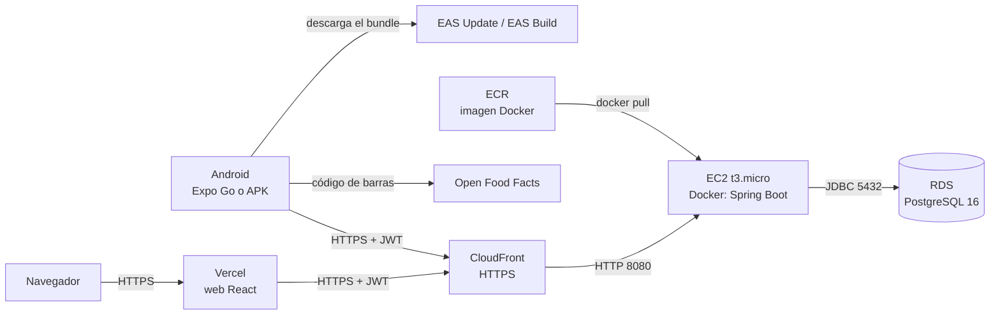
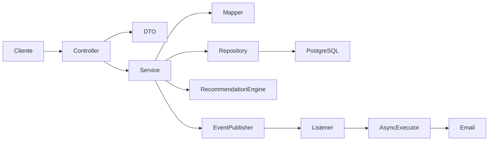
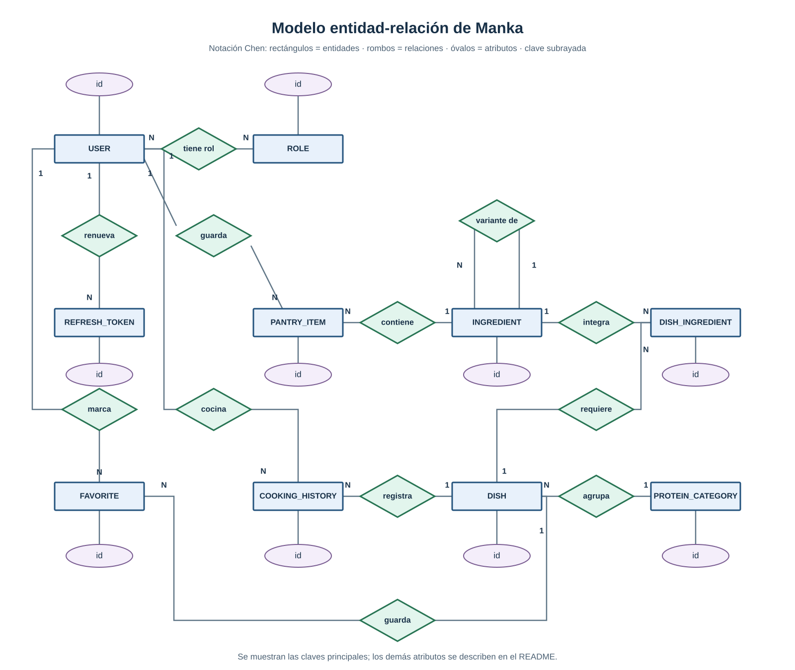

# Manka: qué cocinar con lo que tienes

**Curso:** CS 2031 Desarrollo Basado en Plataformas  
**Proyecto 2:** backend, web, móvil y despliegue. Entrega: 14 de noviembre de 2026.  
**Autor:** Sebastián Lescano.

## Índice

1. [Qué es Manka](#qué-es-manka)
2. [Funciones](#funciones)
3. [Enlaces públicos](#enlaces-públicos)
4. [Stack](#stack)
5. [Arquitectura](#arquitectura)
6. [Ejecución local](#ejecución-local)
7. [Estructura de carpetas](#estructura-de-carpetas)
8. [Backend](#backend)
9. [Despliegue](#despliegue)
10. [Participación](#participación)
11. [Apéndices](#apéndices)

## Qué es Manka

Muchas veces hay ingredientes en casa, pero no está claro qué plato preparar con ellos. Buscar recetas una por una toma
tiempo y suele terminar en opciones para las que faltan cosas o que tardan más de lo que se tiene. Además, repetir siempre
el mismo plato aburre.

Manka recomienda platos peruanos según la despensa del usuario y los minutos que tiene. Cada plato recibe un puntaje de 0
a 100 que combina cinco criterios: ingredientes disponibles (35 %), tiempo (20 %), variedad de proteína (10 %), repetición
reciente (20 %) y popularidad (15 %). La respuesta explica cada criterio y muestra los ingredientes que faltan.

## Funciones

**Web (React)**

- Registro e inicio de sesión con validación en tiempo real; la sesión se renueva sola con el refresh token.
- Recomendaciones según el tiempo elegido, con la mejor opción, su desglose de puntaje y otras opciones.
- Despensa con búsqueda de ingredientes (debounce), agregar y quitar con confirmación.
- Catálogo de platos con búsqueda, filtros y paginación (10/25/50/100 por página, estado en la URL).
- Detalle de plato: ingredientes que tienes y que faltan, favorito y «marcar como cocinado».
- Favoritos, historial y perfil.
- Panel de administración (ADMIN y MANAGER): CRUD de platos, ingredientes y sus relaciones; cambio de roles (ADMIN).
- Rutas protegidas, carga diferida de páginas, breadcrumbs, página 404, modo oscuro, toasts y aviso sin conexión.

**Móvil (React Native con Expo)**

- Inicio de sesión y registro; tokens guardados en SecureStore.
- Recomendaciones, catálogo, detalle, despensa, favoritos, historial y perfil.
- **Cámara:** escanear el código de barras de un producto, buscarlo en Open Food Facts y agregar a la despensa los
  ingredientes que coinciden. Si no hay permiso o cámara, se escribe el código o se busca a mano.
- **Acelerómetro:** agitar el teléfono (o pulsar «Sorpréndeme») abre una recomendación al azar.
- Skeletons, reintentos, mensajes de error amigables, aviso sin conexión y toasts con «Deshacer».

## Enlaces públicos

| Componente | Enlace |
| --- | --- |
| Web (Vercel) | https://manka-dbp.vercel.app |
| API (AWS, CloudFront) | https://d2bql0rp3k9uia.cloudfront.net/api/v1 |
| Swagger UI | https://d2bql0rp3k9uia.cloudfront.net/swagger-ui.html |
| OpenAPI (JSON) | https://d2bql0rp3k9uia.cloudfront.net/v3/api-docs |
| Salud | https://d2bql0rp3k9uia.cloudfront.net/actuator/health |
| Móvil, EAS Update para Expo Go (Android) | https://expo.dev/accounts/seblescano/projects/manka/updates/67f14ec6-0469-4bd7-8adf-d6dc2bdf50ba |
| Móvil, APK de Android | Descarga: https://expo.dev/artifacts/eas/0nu9dBZFPkecfz46r86UfpUjOKrJbfjk3cljvYmjw4w.apk (build: https://expo.dev/accounts/seblescano/projects/manka/builds/752ddd7e-e9b5-4db2-b45d-afe5a26e0c72) |
| Repositorio | https://github.com/slesgmd/Manka_DBP |

**Usuario de demo (rol USER):** `prueba.rutas.1111@manka.pe` / `Prueba1234`.

Para abrir la app en Expo Go: instalar Expo Go en Android, abrir el enlace del update y escanear el código QR «Preview».
El APK se instala directamente desde su página de build.

## Stack

| Capa | Tecnologías |
| --- | --- |
| Backend | Java 25, Spring Boot 3.5.4 (Web, Data JPA, Security, Validation), JJWT, springdoc-openapi, PostgreSQL 16, Maven |
| Web | Vite, React 19, TypeScript, Tailwind CSS 4, React Router 7, axios |
| Móvil | Expo SDK 58, React Native 0.88, TypeScript, React Navigation 7, axios, expo-secure-store, expo-camera, expo-sensors, NetInfo |
| API externa | Open Food Facts (datos de productos por código de barras) |
| Despliegue | AWS (EC2 con Docker, RDS PostgreSQL, ECR, CloudFront), Vercel, EAS Update y EAS Build |
| CI | GitHub Actions (`mvn -B clean verify`) |

## Arquitectura



Dentro del backend:



Los controladores reciben las peticiones y validan los datos. Los servicios tienen las reglas del proyecto y usan los
repositorios para consultar PostgreSQL. La recomendación está separada en criterios pequeños (un `RecommendationScorer`
por criterio) para poder probar cada puntaje. La web y el móvil tienen la misma separación: `services/` (axios con
baseURL e interceptores), `hooks/` y `contexts/` (lógica y estado global) y `components/` y `pages/`/`screens/` (UI).

## Ejecución local

### Backend

Se necesita Docker Compose. Copiar `.env.example` a `.env` y cambiar `DB_PASSWORD` y `JWT_SECRET` (mínimo 32 bytes).
Para usar la web local, `CORS_ALLOWED_ORIGINS` debe incluir `http://localhost:5173`.

```sh
docker compose up --build -d
docker compose ps
```

Comprobar en `http://localhost:8080/actuator/health`. Sin Docker para la app se necesita JDK 25: levantar solo la base con
`docker compose up -d db`, poner las variables de `.env` en la terminal o el IDE con
`DB_URL=jdbc:postgresql://localhost:5432/manka` y ejecutar:

```sh
./mvnw spring-boot:run
./mvnw clean verify
```

En Windows se usa `mvnw.cmd`. Al iniciar se crean los roles y, si el catálogo está vacío, platos e ingredientes de ejemplo
(`MANKA_SEED_ENABLED`). `ADMIN_EMAIL` y `ADMIN_PASSWORD` crean una cuenta administradora en el primer arranque.

| Variable | Uso |
| --- | --- |
| `DB_URL`, `DB_USERNAME`, `DB_PASSWORD` | Conexión a PostgreSQL |
| `JWT_SECRET` | Firma de los access tokens |
| `CORS_ALLOWED_ORIGINS` | Orígenes web permitidos, separados por coma |
| `MAIL_*` | Correo (desactivado por defecto) |
| `ADMIN_EMAIL`, `ADMIN_PASSWORD` | Administrador inicial (opcional) |
| `RECOMMENDATION_WEIGHT_*` | Pesos de los criterios (deben sumar 1) |

### Web

```sh
cd web
cp .env.example .env
npm install
npm run dev
```

`VITE_API_URL` es la URL del backend sin `/api/v1` (`http://localhost:8080` en local). La app queda en
`http://localhost:5173`. `npm run build` genera la versión de producción y `npm run lint` revisa el código.

### Móvil

```sh
cd mobile
cp .env.example .env
npm install
npx expo start
```

`EXPO_PUBLIC_API_URL` es la URL del backend sin `/api/v1`. Desde el teléfono `localhost` no funciona: usar la API
pública o la IP de la computadora en la red. Abrir el QR con Expo Go; si el teléfono está en otra red, usar
`npx expo start --tunnel`.

## Estructura de carpetas

```text
.
├── src/main/java/com/manka/backend/   Backend Spring Boot
│   ├── config/          Seguridad, CORS, OpenAPI, datos iniciales, pesos
│   ├── controller/      Endpoints REST
│   ├── dto/  mapper/    Entrada y salida de la API
│   ├── service/  repository/  model/
│   ├── recommendation/  Motor y criterios de puntaje
│   ├── security/        JWT y filtros
│   └── event/  exception/
├── src/test/            Pruebas (H2)
├── web/src/
│   ├── services/        axios (api.ts) y un servicio por recurso
│   ├── context/         AuthContext y ToastContext
│   ├── hooks/           useAuth, useFetch, useForm, usePagination, ...
│   ├── components/      Componentes reutilizables (ui/, admin/)
│   ├── pages/           Vistas
│   └── routes.ts        Rutas centralizadas
├── mobile/src/
│   ├── services/        axios, SecureStore, Open Food Facts
│   ├── contexts/  hooks/  components/  screens/  navigation/  utils/  types/
├── Dockerfile  docker-compose.yml  postman_collection.json
└── .github/workflows/   CI con Maven
```

## Backend

### Modelo de entidades



[Abrir el diagrama Chen a tamaño completo](assets/modelo-chen.svg). Los rectángulos son entidades, los rombos relaciones y
los óvalos atributos; la clave principal está subrayada.

| Entidad | Atributos principales |
| --- | --- |
| `User` | `id`, `name`, `email`, `passwordHash`, `enabled`, `createdAt` |
| `Role` | `id`, `name` |
| `RefreshToken` | `id`, `tokenHash`, `expiresAt`, `revoked`, `createdAt` |
| `Ingredient` | `id`, `name`, `parentIngredient` |
| `Dish` | `id`, `name`, `totalTimeMinutes`, `proteinCategory` |
| `ProteinCategory` | `id`, `name` |
| `DishIngredient` | `id`, `dish`, `ingredient` |
| `PantryItem` | `id`, `user`, `ingredient`, `addedAt` |
| `Favorite` | `id`, `user`, `dish`, `createdAt` |
| `CookingHistory` | `id`, `user`, `dish`, `cookedAt` |

`Ingredient` puede apuntar a otro ingrediente para representar variantes (pechuga de pollo y pollo). `DishIngredient` une
platos con ingredientes sin duplicados. `PantryItem`, `Favorite` y `CookingHistory` guardan datos de cada usuario. Las
respuestas usan DTOs; las entidades no se exponen.

### Manejo de errores

`GlobalExceptionHandler` da a todos los errores el mismo formato: fecha, código, tipo, mensaje y ruta. 400 datos inválidos,
401 autenticación fallida, 403 sin permisos, 404 recurso inexistente, 409 duplicado o restricción, 500 sin detalles
internos. Los DTOs se validan con `@Valid`, `@NotBlank`, `@Email`, `@Positive`, etc.

### Seguridad

El registro asigna el rol `USER`. `MANAGER` y `ADMIN` editan el catálogo; solo `ADMIN` cambia roles. El access token es un
JWT de 15 minutos y el refresh token es una cadena aleatoria de 7 días guardada con hash, que se rota en cada uso y se
revoca al cerrar sesión. Las contraseñas usan BCrypt. Los secretos están fuera del repositorio. CORS solo acepta los
orígenes configurados; la API no usa sesiones ni cookies.

### Eventos y asincronía

Registrarse, cocinar un plato o agregar un favorito publica un evento. Los listeners corren después de confirmar la
transacción y con `@Async`, así la respuesta no espera al correo. El correo está desactivado por defecto.

### Endpoints

Todas las rutas empiezan con `/api/v1`, salvo Actuator. La colección [postman_collection.json](postman_collection.json)
tiene ejemplos; su variable `{{baseUrl}}` se cambia a la API pública o a `http://localhost:8080`.

| Recurso | Rutas y métodos | Acceso principal |
| --- | --- | --- |
| Auth | `POST /auth/register`, `/login`, `/refresh`, `/logout` | Público |
| Users | `GET /users/me`, `GET /users`, `PATCH /users/{id}/roles` | Usuario / ADMIN |
| Dishes | `GET`, `GET /{id}`, `POST`, `PUT /{id}`, `DELETE /{id}` | Lectura pública; escritura ADMIN/MANAGER |
| Ingredients | `GET`, `GET /{id}`, `POST`, `PUT /{id}`, `DELETE /{id}` | Lectura pública; escritura ADMIN/MANAGER |
| Protein Categories | `GET`, `GET /{id}`, `POST`, `PUT /{id}`, `DELETE /{id}` | Lectura pública; escritura ADMIN/MANAGER |
| Dish Ingredients | `GET`, `GET /{id}`, `POST`, `PUT /{id}`, `DELETE /{id}` | Lectura pública; escritura ADMIN/MANAGER |
| Pantry, Favorites, Cooking History | `GET`, `POST`, `DELETE /{id}` | Usuario autenticado |
| Recommendations | `GET /recommendations?availableMinutes=45&limit=10` | Usuario autenticado |
| Status / Health | `GET /status`, `GET /actuator/health` | Público |

## Despliegue

- **Backend:** imagen Docker en ECR, contenedor en una EC2 t3.micro (us-east-2) con variables en un archivo de entorno
  fuera del repositorio. Solo CloudFront puede llegar al puerto 8080 de la instancia; CloudFront da HTTPS.
- **Base de datos:** RDS PostgreSQL 16 privada; solo acepta conexiones desde la EC2.
- **Web:** Vercel desde `main` (carpeta `web`), con `VITE_API_URL` como variable de entorno y un rewrite a `index.html`
  para las rutas de React Router. El dominio de Vercel está en los orígenes CORS del backend.
- **Móvil:** EAS Update en la rama `production` (se abre en Expo Go) y un APK de Android con EAS Build. La URL de la API
  viene de `EXPO_PUBLIC_API_URL` en el entorno de EAS.
- **CI:** GitHub Actions compila y ejecuta las pruebas en cada push.

## Participación

| Integrante | Aportes principales | Participación |
| --- | --- | --- |
| Sebastián Lescano | Todos los componentes: backend, web, móvil y despliegue | 100 % |

## Apéndices

**Licencia:** MIT. Véase [LICENSE](LICENSE).

**Referencias:** materiales de clase de CS 2031; [Spring Boot](https://docs.spring.io/spring-boot/reference/);
[React](https://react.dev/); [Expo](https://docs.expo.dev/); [Open Food Facts API](https://openfoodfacts.github.io/openfoodfacts-server/api/);
[AWS](https://docs.aws.amazon.com/); [Vercel](https://vercel.com/docs).
